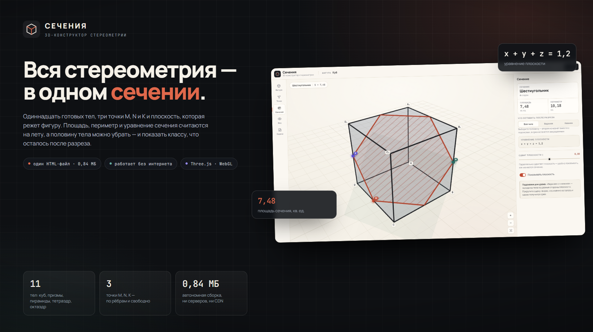
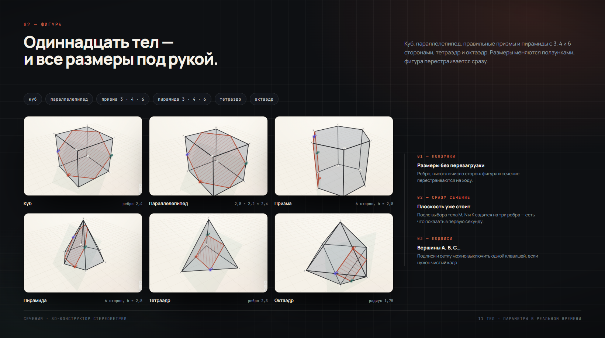
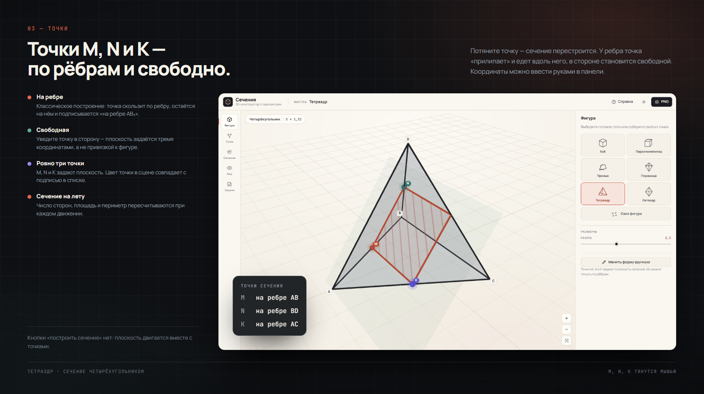
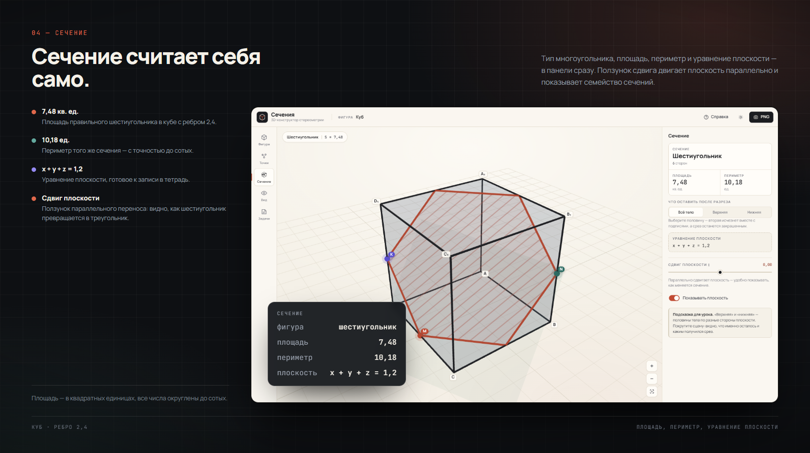
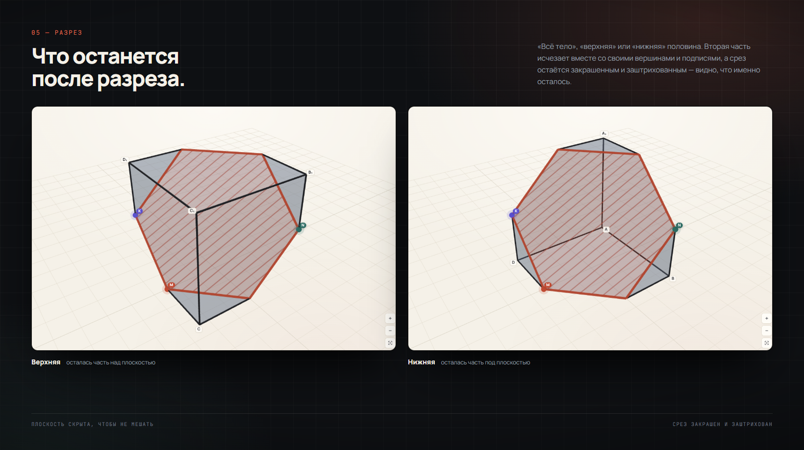
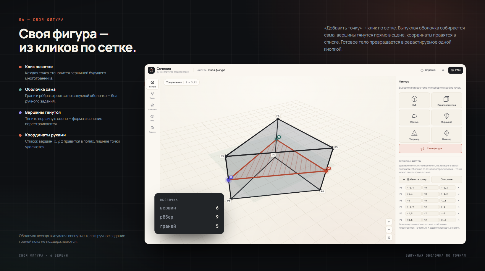
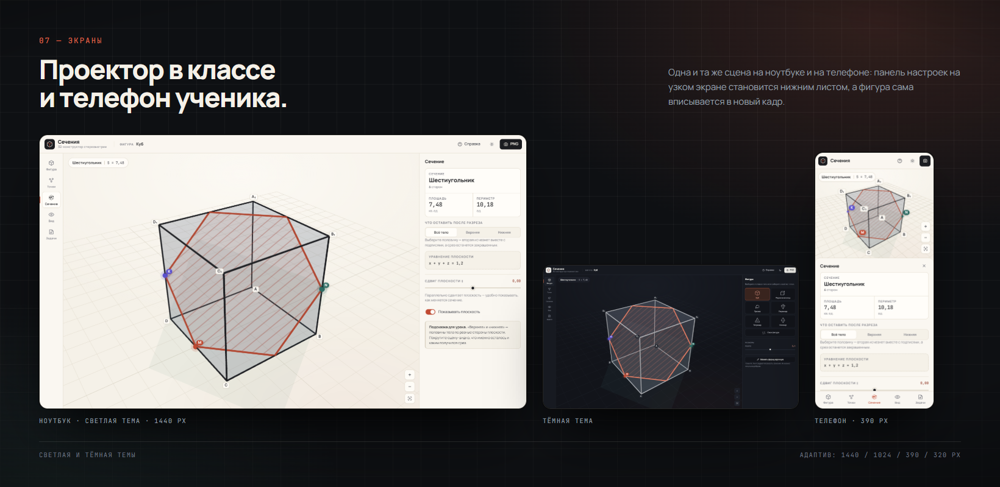

<div align="center">



<br />

# Сечения

### 3D-конструктор стереометрии для уроков
**Одиннадцать тел, три точки M, N и K и плоскость, которая режет фигуру**

<p align="center">
  <a href="https://thebenua.github.io/stereometry/">
    
  </a>
  <a href="https://github.com/Thebenua/stereometry/raw/main/dist/secheniya.html">
    
  </a>
  <a href="https://github.com/Thebenua/stereometry">
    
  </a>
</p>

<p align="center">
  
  
  
  
  
</p>

<p align="center">
  <a href="#что-умеет">Возможности</a> ·
  <a href="#визуальный-обзор">Экраны</a> ·
  <a href="#сценарии-урока">Сценарии урока</a> ·
  <a href="#архитектура">Архитектура</a> ·
  <a href="#как-открыть">Как открыть</a> ·
  <a href="#ограничения">Ограничения</a>
</p>

</div>

---

## О проекте

На уроке стереометрии сечение приходится либо рисовать от руки, либо показывать заранее собранным апплетом. В GeoGebra-заготовках нельзя свободно двигать точки и строить свои тела, а статичная картинка не отвечает на вопрос «а что будет, если плоскость сдвинуть?».

**Сечения** решают это в браузере, без установки и регистрации:

- **Для учителя** — сцена открывается рабочей: куб, три точки на рёбрах и готовое сечение. Тело выбирается в один клик, размеры — ползунками, точки M, N, K тянутся мышью, а площадь, периметр и уравнение плоскости уже посчитаны. «Верхняя» или «нижняя» половина убирает лишнюю часть тела вместе с подписями — видно, что именно осталось после разреза.
- **Для ученика** — та же сцена на телефоне: панель настроек становится нижним листом, фигура подстраивается под экран. Ссылка с состоянием сохраняет всё: тело, точки, ракурс и тему.

Проект сделан как замена связке «GeoGebra + заранее собранные апплеты» для учительницы математики и как рабочий кейс в портфолио.

---

## Что умеет

- **11 готовых тел:** куб, параллелепипед, правильные призмы и пирамиды с 3, 4 и 6 сторонами, тетраэдр, октаэдр. Размеры — ползунками.
- **Точки сечения M, N, K.** У ребра точка «прилипает» и едет вдоль него, в стороне становится свободной. Координаты вводятся и руками.
- **Сечение:** тип многоугольника, площадь, периметр, уравнение плоскости. Параллельный сдвиг плоскости показывает семейство сечений.
- **«Что оставить после разреза»:** всё тело, верхняя или нижняя половина. Вторая часть исчезает вместе со своими вершинами, срез остаётся закрашенным и заштрихованным.
- **Своя фигура:** «Добавить точку» → клик по сетке, выпуклая оболочка строится сама, вершины тянутся в сцене, координаты правятся в списке.
- **Оформление:** светлая и тёмная темы, прозрачность граней, подписи, сетка, оси, ракурсы (изометрия, спереди, сверху, сбоку).
- **Экспорт:** PNG с подписями и полями, проект в `.json`, ссылка с состоянием в адресе страницы.
- **Задачи:** четыре готовых сценария для урока.

---

## Визуальный обзор

### 1. Одиннадцать тел — и все размеры под рукой

<p align="center">
  
</p>

- **Куб и параллелепипед, призмы и пирамиды, тетраэдр и октаэдр** — 11 тел, каждое со своим набором размеров.
- **Размеры ползунками:** ребро, высота, число сторон основания. Фигура и сечение перестраиваются на ходу, без перезагрузки.
- **Сечение по умолчанию:** после выбора тела плоскость уже стоит на трёх серединах рёбер — есть что показать с первой секунды.
- **Подписи вершин** (A, B, C…, A₁, B₁…) включаются и выключаются вместе с сеткой одной клавишей — для чистого кадра.

<br />

### 2. Точки M, N и K — по рёбрам и свободно

<p align="center">
  
</p>

- **Точка на ребре** — классическое построение: точка скользит по ребру, остаётся на нём и подписывается «на ребре AB₁».
- **Свободная точка** — уведите её в сторону, и плоскость будет задана тремя координатами, а не привязкой к фигуре.
- **Ровно три точки** M, N и K задают плоскость; цвет точки в сцене совпадает с подписью в списке.
- **Пересчёт на лету:** число сторон, площадь и периметр меняются при каждом движении — кнопки «построить сечение» нет.

<br />

### 3. Сечение считает себя само

<p align="center">
  
</p>

- **Тип сечения** — треугольник, четырёхугольник, …, шестиугольник — определяется по числу сторон.
- **Площадь и периметр** выводятся с точностью до сотых в квадратных и линейных единицах.
- **Уравнение плоскости** вида `x + y + z = 1,2` — готово к записи в тетрадь.
- **Сдвиг плоскости** — ползунок параллельного переноса: видно, как шестиугольник превращается в четырёхугольник и треугольник.

<br />

### 4. Что останется после разреза

<p align="center">
  
</p>

- **Три режима:** «всё тело», «верхняя», «нижняя». «Верхняя» — та половина, где оказался верх фигуры, независимо от порядка точек M, N, K.
- **Вторая часть исчезает** вместе со своими вершинами и подписями, а срез остаётся закрашенным и заштрихованным.
- **Плоскость в этом режиме скрывается**, чтобы не закрывать то, что осталось после рассечения.

<br />

### 5. Своя фигура — из кликов по сетке

<p align="center">
  
</p>

- **«Добавить точку» → клик по сетке:** каждая точка становится вершиной будущего многогранника.
- **Выпуклая оболочка** по точкам строится сама — грани и рёбра задавать вручную не нужно.
- **Вершины тянутся** прямо в сцене: форма и сечение перестраиваются.
- **Координаты руками:** список вершин с полями x, y, z и удалением лишних точек. Кнопка «Менять форму вручную» превращает любое готовое тело в редактируемое.

---

## Панорама интерфейса

<p align="center">
  
</p>

Интерфейс построен на собственной дизайн-системе «бумага и тушь» ([`design/SYSTEM.md`](design/SYSTEM.md)): тёплый фон `#F5F1E8`, графитовые рёбра `#25272D`, киноварь сечения `#C14A32`, бирюзовая плоскость `#2C6B62`, вариативная кириллическая типографика **Manrope** и моноширинные числа **JetBrains Mono**. Штриховка сечения под 45° — узнаваемый приём проекта. Всё, включая шрифты и Three.js, лежит локально: страница не зависит от CDN и работает без интернета.

---

## Сценарии урока

| № | Сценарий | Что показать |
| :-: | :--- | :--- |
| **1** | **Куб: правильный шестиугольник** | Плоскость через середины трёх рёбер. Стороны сечения равны — удобно считать площадь. |
| **2** | **Куб: равносторонний треугольник** | Сечение через вершины A, C и B₁. Почему треугольник равносторонний? |
| **3** | **Пирамида: сечение через рёбра** | Четырёхугольная пирамида, плоскость через середины боковых рёбер. Сравните с основанием. |
| **4** | **Призма: разрез и семейство сечений** | Половина «верхняя» + сдвиг плоскости: четырёхугольник превращается в треугольник. |

Каждый сценарий — готовая кнопка в разделе «Задачи»: тело, точки и ракурс выставляются сами.

---

## Управление

| Действие | Как |
| :--- | :--- |
| Вращать сцену | левая кнопка + тянуть по пустому месту |
| Двигать сцену | правая кнопка или Shift + тянуть |
| Приблизить | колесо, щипок, кнопки +/− |
| Двигать точку M/N/K | тянуть точку |
| Двигать вершину своей фигуры | тянуть вершину |
| Вписать фигуру | двойной клик или кнопка в углу |

Горячие клавиши: `1`–`5` — разделы, `T` — тема, `G` — сетка, `L` — подписи, `P` — PNG, `R` — вписать, `Esc` — отмена добавления точки.

---

## Архитектура

```text
stereometry/
├── index.html                  # разметка приложения: рейка, сцена, панель
├── assets/
│   ├── css/app.css             # дизайн-система «бумага и тушь», адаптив
│   ├── js/app.js               # состояние, интерфейс, точки, сценарии урока, ссылки
│   ├── js/viewer.js            # Three.js: сцена, материалы, штриховка, разрез, PNG
│   ├── js/solids.js            # геометрия: тела, оболочка по точкам, сечения, формулы
│   └── fonts/                  # Manrope и JetBrains Mono (кириллица + латиница)
├── vendor/three/               # Three.js 0.160 и ConvexHull локально
├── dist/
│   ├── secheniya.html          # автономная сборка одним файлом (0,84 МБ)
│   └── .nojekyll
├── design/
│   ├── BRIEF.md                # бриф: аудитория, задача, тон
│   ├── SYSTEM.md               # палитра, типографика, компоненты, адаптив
│   ├── screens/                # скриншоты приложения
│   └── showcase/               # широкоформатные иллюстрации для README
├── build.mjs                   # сборка одного файла через esbuild
└── README.md
```

Внешних CDN нет: шрифты, Three.js и стили лежат в репозитории, поэтому страница не зависит от доступности esm.sh или Google Fonts.

---

## Как открыть

### Способ 1. Просто открыть файл (без интернета и сервера)

Скачайте [`dist/secheniya.html`](dist/secheniya.html) и откройте двойным кликом. Это один автономный файл: внутри Three.js, стили и шрифты. Работает в Chrome, Edge, Firefox, Safari.

### Способ 2. Живая ссылка

[**thebenua.github.io/stereometry**](https://thebenua.github.io/stereometry/) — та же сцена, отдаётся с GitHub Pages. ES-модули работают только по HTTP, поэтому для разработки нужен локальный сервер:

```powershell
python -m http.server 8781 --directory .
# → http://127.0.0.1:8781/
```

### Способ 3. Сборка автономного файла

```powershell
npm install
node build.mjs        # → dist/secheniya.html
```

Сборка кладёт разметку, стили, скрипты, шрифты и Three.js в один HTML-файл через esbuild.

### На интерактивной панели Android

Тот же адрес открывается на сенсорной панели вместо проектора. Жесты проверены эмуляцией касаний в Chrome: перетаскивание точки M, вращение сцены, щипок для зума и двойной тап «вписать фигуру» работают, а `touch-action: none` на сцене не даёт странице прокручиваться под пальцем.

- Открывайте **ссылку в Chrome**, а не файл из «Загрузок» через файловый менеджер: так предсказуемо работают ES-модули и скачивание PNG.
- На 4K-панели с плотностью экрана 1 интерфейс будет мелким (панель настроек — 352 px из 3840): увеличьте масштаб страницы в меню Chrome до 125–150 %.
- На реальной панели не проверял — GPU и версия Chrome там свои, поэтому первый запуск лучше сделать заранее, до урока.

### Публикация

Статический сайт без серверной части. Для GitHub Pages достаточно включить **Settings → Pages → Deploy from a branch → `main` / (root)**: `index.html` откроется как приложение, а `dist/secheniya.html` останется файлом для скачивания.

---

## Ограничения

- Своя фигура строится как **выпуклая оболочка** по точкам: вогнутые многогранники и ручное задание граней пока не поддерживаются.
- Нет тел вращения (цилиндр, конус, шар) и их сечений — там нужны кривые, это следующий крупный шаг.
- Нет наклонных призм и усечённых пирамид.
- Разрез не «раздвигает» половины: включён режим отсечения, а не анимация разъезда.

---

<div align="center">
  <sub>Сделано как учебный инструмент для уроков геометрии · 2026</sub>
</div>
